# rust-ownership-optimizer

[](https://github.com/ichbinrather/rust-ownership-optimizer/actions/workflows/ci.yml)
[](LICENSE)

A skill for AI coding agents that work on Rust. It stops them from reaching for
`.clone()`, `Box`, `Rc<RefCell<_>>` or `'static` whenever the borrow checker complains,
and makes them fix the ownership instead.

Works with Claude Code, Codex CLI, Cursor, GitHub Copilot, Gemini CLI, OpenCode, and
anything else that reads `SKILL.md` or `AGENTS.md`.

<p align="center">
  
</p>

## Why

Ask an agent to fix `error[E0382]: borrow of moved value` and a common answer is:

```rust
print_report(report.clone());
archive(report);
```

It compiles, and it copies the whole report on every call. `print_report` only reads
its argument, so the right fix is a borrow:

```rust
fn print_report(report: &Report) { /* ... */ }

print_report(&report);
archive(report);
```

The skill gives the agent a short procedure for this kind of decision: work out who
should own the data, map the compiler error to a design question, go through a
checklist (clones, boxes, borrow conflicts, allocations, lifetimes, smart pointers),
and confirm with `cargo check` and Clippy. If the same error survives three attempts,
it rethinks the data layout instead of adding another workaround.

## Install

### Windows

```powershell
git clone https://github.com/ichbinrather/rust-ownership-optimizer.git
cd rust-ownership-optimizer
powershell -ExecutionPolicy Bypass -File .\install.ps1
```

### macOS / Linux

```bash
git clone https://github.com/ichbinrather/rust-ownership-optimizer.git
cd rust-ownership-optimizer
./install.sh
```

The script looks for the config folders of the supported agents (`.claude`, `.codex`,
`.cursor`, ...) in your home directory and copies the skill into each one it finds.
Restart the agent afterwards.

Options:

- `-Link` / `--link`: link to the clone instead of copying it, so `git pull` updates
  the skill. On Windows this creates a directory junction, which does not need admin
  rights.
- `-All` / `--all`: also install for agents whose folder does not exist yet.
- `-Force` / `--force`: overwrite an existing install.

If you have Node.js, `npx skills add ichbinrather/rust-ownership-optimizer` works too.

### Installing by hand

Copy the repository into the agent's skills folder under the name
`rust-ownership-optimizer`, so that `SKILL.md` ends up directly inside it.

| Agent | Skills folder |
|-------|---------------|
| Claude Code | `~/.claude/skills` |
| Codex CLI | `~/.codex/skills` or `~/.agents/skills` |
| OpenCode | `~/.config/opencode/skills` |
| Cursor | `~/.cursor/skills` |
| Gemini CLI | `~/.gemini/skills` |
| GitHub Copilot | `~/.copilot/skills` |

On Windows, `~` is `%USERPROFILE%`. These paths have moved between agent versions
before, so check your agent's docs if the skill does not show up.

To use it in a single project, put it in `.claude/skills/` inside the repository and
copy `AGENTS.md` to the project root. Agents without skill support can use the rules
in `AGENTS.md` directly: paste them into `.github/copilot-instructions.md`,
`.cursor/rules/`, `GEMINI.md`, `.windsurf/rules/`, or `.clinerules/`.

### Checking that it loaded

Restart the agent and ask which skills it has, or call it by name
(`/rust-ownership-optimizer` in Claude Code, `$rust-ownership-optimizer` in Codex). On a
Rust project, ask it to review a file for unnecessary clones. Findings come back like
this:

```text
[clone] src/report.rs:42: report cloned for a read-only call -> take &Report
[box] src/shapes.rs:10: Box<dyn Shape> parameter only borrowed -> &dyn Shape
```

### Updating and removing

With a linked install, `git pull` is enough. With a copied install, pull and run the
installer again with `-Force` / `--force`.

To remove it, delete `rust-ownership-optimizer` from the agent's skills folder. If you
installed with `-Link` on Windows, remove the junction with `cmd /c rmdir <path>`.
In Windows PowerShell 5.1, `Remove-Item -Recurse` on a junction can delete the files in
your clone as well.

If PowerShell says that running scripts is disabled, use the
`-ExecutionPolicy Bypass` form shown above. It applies to that single run only.

## What it covers

- Clones that only exist to satisfy the compiler: read-only arguments, comparisons,
  loops, inspecting an `Option`.
- `Box` that adds indirection without a reason: `Box<Vec<T>>`, boxed locals,
  `Box<dyn Trait>` parameters where a reference would do.
- Borrow checker errors E0382, E0499, E0502, E0505, E0506, E0507, E0515, E0597, E0716,
  E0106 and E0596, with fixes that do not copy data
  ([references/error-codes.md](references/error-codes.md)).
- Closures, `thread::scope`, `Arc` for spawned tasks, iterator adapters, the "get or
  insert" case the current borrow checker rejects, `Cow`, and index-based graphs
  ([references/patterns.md](references/patterns.md)).
- Escape hatches it will not use: `'static` to silence a lifetime error, `Box::leak`,
  `unsafe`, and `Rc<RefCell<_>>` everywhere.

The full instructions are in [SKILL.md](SKILL.md).

## Diff guard

Strong models rarely take the `.clone()` shortcut when the task is "fix this borrow
error". It happens when a borrow error shows up in the middle of some other task and
the clone is the fastest way back. `scripts/ownership_guard.py` catches that case: it
looks only at the lines added in the current change and lists new `.clone()`,
`.to_owned()`, `.to_vec()`, `Rc<RefCell<_>>`, `Arc<Mutex<_>>`, `'static`, `Box::leak`,
`unsafe`, and boxed collections. Existing code is ignored.

```text
$ python scripts/ownership_guard.py
src/game.rs:41: [clone] new .clone(): borrow, move on last use, or share with Arc/Rc instead
    for p in self.players.clone() {

1 new ownership workaround(s). For each one, either fix it or add a specific
justification on the same line or the line above, e.g. `// ownership: snapshot must outlive the lock`.
```

A finding goes away when the line is fixed or carries a reason:
`// ownership: worker thread needs its own copy`. `Rc::clone(&x)` and `Arc::clone(&x)`
are never flagged. It needs Python 3.8+ and git, and works on Windows, macOS and Linux.

The skill tells the agent to run the guard before it finishes. You can also run it
automatically in three places.

**After every edit in Claude Code.** Add a hook to `~/.claude/settings.json` (or
`.claude/settings.json` in a project). The guard's output is sent back to the agent,
which then fixes or justifies each finding:

```json
{
  "hooks": {
    "PostToolUse": [
      {
        "matcher": "Edit|MultiEdit|Write",
        "hooks": [
          {
            "type": "command",
            "command": "python3 \"$HOME/.claude/skills/rust-ownership-optimizer/scripts/ownership_guard.py\" --hook claude"
          }
        ]
      }
    ]
  }
}
```

Use `python` instead of `python3` if that is the name on your system, and adjust the
path if you installed the skill elsewhere.

**Before every commit.** Save this as `.git/hooks/pre-commit` in your project (on macOS
and Linux, also run `chmod +x .git/hooks/pre-commit`):

```sh
#!/bin/sh
python3 path/to/ownership_guard.py --staged
```

**In pull requests.** Copy `ownership_guard.py` into your repository and add a step to
your GitHub Actions workflow:

```yaml
- uses: actions/checkout@v4
  with:
    fetch-depth: 0
- run: python3 scripts/ownership_guard.py --base origin/${{ github.base_ref }}
  if: github.event_name == 'pull_request'
```

## Examples

Each rule has a before/after program you can run:

```text
cargo run --example unnecessary_clone
cargo run --example unnecessary_box
cargo run --example borrow_conflicts
cargo run --example advanced_patterns
```

To audit your own project with the same Clippy lints the skill uses, run
`scripts/audit.ps1` (Windows) or `scripts/audit.sh` from the project root.

## Evals

[evals/](evals/) has six small programs with mistakes an agent should catch, together
with the prompt to give it and what counts as a pass. One of them pushes the agent to
"just make it compile".

Results so far, all on Claude Sonnet:

- When fixing a borrow error **is** the task, Sonnet rarely takes a shortcut with or
  without the skill: 29/30 clean runs without it, 30/30 with it.
- When the borrow problem shows up **inside a feature task**, it is different. Asked to
  add a game `tick()` that logs and heals players while iterating them, all three runs
  without the skill cloned every player's name on every tick to get past the borrow
  checker. None of the six runs with the skill did.

That is a small sample and one model. Smaller models are not tested yet. Details, the
projects, and every patch are in [evals/RESULTS.md](evals/RESULTS.md).

If you run the evals with another agent or model, please post the results in an issue.

## Contributing

The most useful report is a case where the agent still did the wrong thing with the
skill installed. There is an issue template for that. For new rules, examples or evals,
see [CONTRIBUTING.md](CONTRIBUTING.md).

For broader Rust coverage (error handling, async, domain-specific advice), have a look
at [actionbook/rust-skills](https://github.com/actionbook/rust-skills).

## License

MIT
